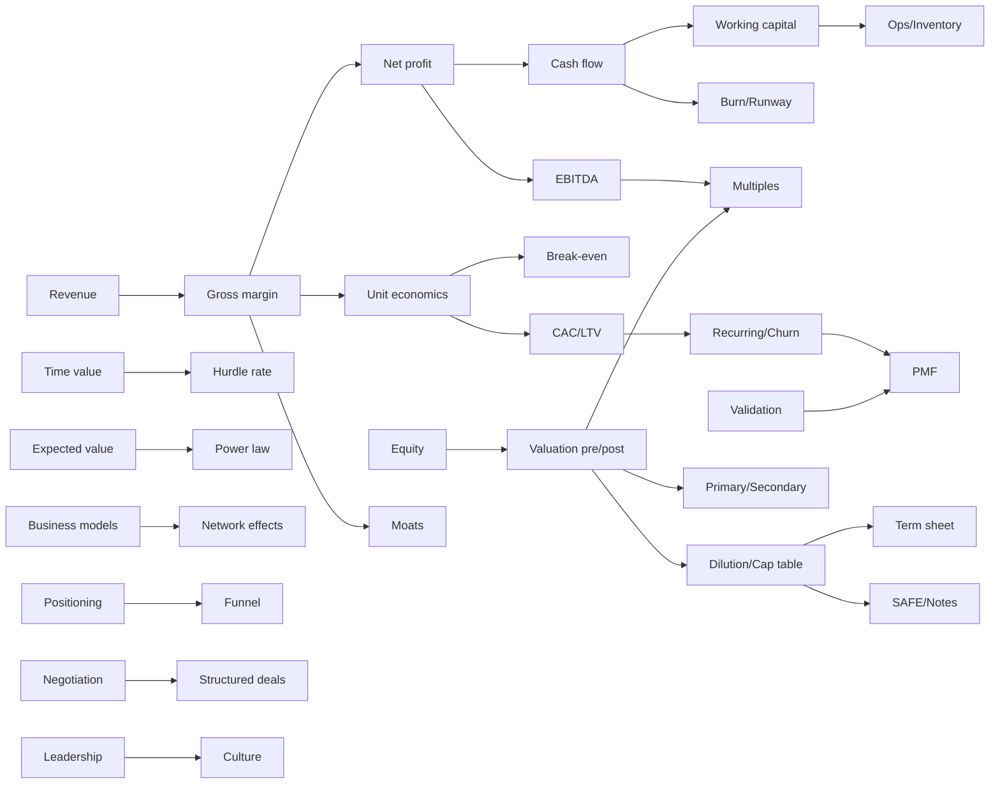

# Concept Map & Curriculum Allocation

مصدر الحقيقة لترتيب المنهج. أي حلقة جديدة لازم يتحدد مكانها هنا الأول.

## 1. المفاهيم الأساسية (Concept nodes)

| ID | المفهوم | Domain | بيعتمد على |
|---|---|---|---|
| C01 | Revenue (الإيرادات) | Finance | — |
| C02 | COGS, Gross profit & Gross margin | Finance | C01 |
| C03 | Operating expenses & Net profit | Finance | C02 |
| C04 | Cash flow ≠ Profit | Finance | C03 |
| C05 | Working capital | Finance / Ops | C04 |
| C06 | Contribution margin & Unit economics | Finance | C02 |
| C07 | Break-even | Finance | C06 |
| C08 | CAC, LTV, Payback | Marketing / Finance | C06 |
| C09 | Recurring revenue & Churn | Finance / Business models | C01, C08 |
| C10 | Equity & Ownership | Investment | — |
| C11 | Valuation: pre-money / post-money | Investment | C10 |
| C12 | Dilution & Cap table | Investment | C11 |
| C13 | Primary vs Secondary transaction | Investment | C11 |
| C14 | Valuation multiples (Revenue, EBITDA) | Investment | C11, C02, C15 |
| C15 | EBITDA & its limits | Finance | C03, C04 |
| C16 | Burn rate & Runway | Finance | C04 |
| C17 | TAM / SAM / SOM | Strategy / Marketing | C01 |
| C18 | Due diligence | Investment | C03, C10 |
| C19 | Convertible notes & SAFEs | Investment | C11, C12 |
| C20 | Opportunity cost & Hurdle rate | Investment | C21 |
| C21 | Time value of money (+ inflation) | Finance | — |
| C22 | Risk, Uncertainty & Expected value | Investment / Decisions | — |
| C23 | Portfolio & Power law | Investment | C22 |
| C24 | Competitive advantage (Moats) | Strategy | C02 |
| C25 | Pricing strategy | Marketing / Strategy | C02, C06 |
| C26 | Segmentation & Positioning | Marketing | — |
| C27 | Sales funnel & Conversion | Sales | C26 |
| C28 | Product–market fit | Entrepreneurship | C29, C09 |
| C29 | Validation & MVP | Entrepreneurship | — |
| C30 | Capacity, Bottlenecks & Inventory | Operations | C05 |
| C31 | Hiring, Delegation & Leadership | Leadership | — |
| C32 | Negotiation: BATNA & Anchoring | Negotiation | — |
| C33 | Term sheet terms (Liquidation pref, Vesting) | Investment | C12 |
| C34 | Business model archetypes | Business models | C01, C02 |
| C35 | Network effects | Strategy | C34 |
| C36 | Royalty & Structured deals | Investment / Negotiation | C01, C32 |
| C37 | Debt vs Equity financing | Finance | C10, C21 |
| C38 | Exits (M&A, IPO, Buyback) | Investment | C11 |
| C39 | Incentives & Culture | Leadership | C31 |
| C40 | Reading financial statements | Finance | C03, C04, C05 |

## 2. خريطة الاعتماد (مختصرة)

## 3. توزيع المنهج على السلاسل الخمسة

> **Episode ID** = `S<series>-<nn>`. **Folder ID** في `episodes/` = رقم السلسلة + رقم الحلقة (`203` = S2-03)، ما عدا S1-01 اللي فولدرها `001` عشان الأمر `build:episode -- 001` يفضل شغال.
> **★ = Pilot** متطوّر بالكامل.
> كل سلسلة ليها **زاوية مختلفة** على المفاهيم المشتركة (القاموس = إيه هو وإزاي يتحسب، والمستثمر = إزاي يأثر على قرارك، والثقة = إزاي تقدّمه وتدافع عنه، والشفرة = شوفه في شركة حقيقية، والفكرة = إزاي تبنيه).

### S1 — قاموس المستثمر (`dictionary`): Finance و Investment
| # | الموضوع | Concepts | Prereq |
|---|---|---|---|
| 01 ★ | Valuation: يعني إيه "اتقيّم بـ 20 مليون"؟ | C11, C13, C14 (مقدمة) | C10 (بيتشرح جوه الحلقة) |
| 02 | Revenue vs Profit vs Cash | C01, C03, C04 | — |
| 03 | Gross margin | C02 | S1-02 |
| 04 | Equity: يعني إيه تملك 10%؟ | C10 | — |
| 05 | Dilution عبر الجولات | C12 | S1-01, S1-04 |
| 06 | Primary vs Secondary | C13 | S1-01 |
| 07 | Royalty deal | C36 | S1-02 |
| 08 | Debt vs Equity | C37 | S1-04, S2-02 |
| 09 | EBITDA وحدوده | C15 | S1-02, S1-03 |
| 10 | Revenue & EBITDA multiples | C14 | S1-01, S1-09 |
| 11 | Burn rate & Runway | C16 | S1-02 |
| 12 | Working capital | C05 | S1-02 |
| 13 | Break-even | C07 | S1-14 |
| 14 | Contribution margin & Unit economics | C06 | S1-03 |
| 15 | CAC, LTV & Payback | C08 | S1-14 |
| 16 | Recurring revenue & Churn | C09 | S1-15 |
| 17 | TAM/SAM/SOM | C17 | S1-02 |
| 18 | Cap table | C12 | S1-05 |
| 19 | Convertible notes & SAFEs | C19 | S1-18 |
| 20 | Liquidation preference & Vesting | C33 | S1-18 |

> **استثناء مقصود:** S1-01 بتتنشر الأول لأنها أكتر سؤال بيتسمع في البرنامج، فبتقدّم C14 (multiples) وC02 (gross margin) **كفكرة** بس. الحلقات S1-03 وS1-10 هي اللي بتشرحهم بعمق.

### S2 — فكّر زي المستثمر (`investor-mind`): Investment و Decisions و Negotiation
| # | الموضوع | Concepts | Prereq |
|---|---|---|---|
| 01 | المستثمر بيشتري المستقبل مش الماضي | C04, C21 | S1-02 |
| 02 | جنيه النهارده ≠ جنيه بعد سنة | C21 | — |
| 03 ★ | مشروع بيكسب 20% في السنة… وممكن يكون صفقة وحشة (Hurdle rate) | C20, C21 | S2-02 |
| 04 | Expected value | C22 | — |
| 05 | Downside first | C22 | S2-04 |
| 06 | Risk vs Uncertainty | C22 | S2-04 |
| 07 | Power law: ليه المستثمر متوقع إن أغلب الصفقات تفشل | C23 | S2-04 |
| 08 | Margin of safety | C22, C11 | S1-01, S2-05 |
| 09 | الفريق ولا الفكرة؟ | C31 | — |
| 10 | Smart money: المستثمر بيدّي إيه غير الفلوس | C13 | S1-06 |
| 11 | BATNA | C32 | — |
| 12 | Anchoring وأول رقم | C32 | S2-11 |
| 13 | هيكل الصفقة كأداة لإدارة المخاطرة | C36 | S1-07, S2-05 |
| 14 | Capital allocation | C20 | S2-03 |
| 15 | Sunk cost | C22 | S2-04 |
| 16 | Concentration vs Diversification | C23 | S2-07 |
| 17 | Base rates: تشكك صحي في التوقعات | C22 | S2-04 |
| 18 | انحيازات بتبوّظ القرار (FOMO و Confirmation bias) | C22 | S2-17 |
| 19 | المستثمر بيرجّع فلوسه إزاي؟ (Exits) | C38 | S1-06 |
| 20 | Investment thesis | C20, C24 | S2-03, S4-10 |

> **ملاحظة:** الاسم اتغيّر من اسم فيه شخص حقيقي لـ "فكّر زي المستثمر" (2026-11-05). القاعدة لسه سارية: مفيش رأي أو قرار منسوب لمستثمر حقيقي من غير مصدر.

### S3 — إزاي تكسب ثقة الشاركس؟ (`trust`): Pitching و Credibility و Negotiation و Sales
| # | الموضوع | Concepts | Prereq |
|---|---|---|---|
| 01 | أول 30 ثانية: المشكلة قبل الحل | C26 | — |
| 02 | الأرقام اللي لازم تعرفها من غير ما تبص في ورقة | C01–C04 | S1-02 |
| 03 | Traction حقيقي vs Vanity metrics | C09, C27 | S1-16 |
| 04 | إزاي تدافع عن تقييمك | C11, C14 | S1-01, S1-10 |
| 05 | Use of funds: الفلوس هتعمل إيه؟ | C16 | S1-11 |
| 06 | "تقييمك عالي": إزاي ترد | C32, C11 | S2-11, S3-04 |
| 07 ★ | الاتفاق على الهوا مش آخر الحكاية: Due diligence | C18 | S1-02 |
| 08 | Customer concentration | C18, C22 | S3-07 |
| 09 | Founder–market fit | C31 | — |
| 10 | المنافسة: متقولش "مالناش منافسين" | C24 | S4-10 |
| 11 | Projections بتتصدق | C21, C22 | S2-17 |
| 12 | Unit economics في الـ pitch | C06, C08 | S1-15 |
| 13 | إمتى تقول "لأ" لعرض | C32 | S2-11 |
| 14 | تختار المستثمر الصح | C13 | S2-10 |
| 15 | Red flags في الـ term sheet | C33 | S1-20 |
| 16 | Data room | C18, C40 | S3-07 |
| 17 | Investor updates بعد الصفقة | C16 | S3-05 |
| 18 | إزاي تقول خبر وحش للمستثمر | C16 | S3-17 |
| 19 | تقسيم الحصص بين الـ co-founders | C10, C33 | S1-04, S1-20 |
| 20 | Pitch post-mortem: إعادة بناء pitch اترفض | — | S3-01..06 |

### S4 — فك شفرة البيزنس (`decode`): Business models و Strategy على شركات حقيقية
| # | الموضوع | Case (مصدر أولي مطلوب) | Prereq |
|---|---|---|---|
| 01 | الفلوس بتدخل منين؟ قراءة أي business model | كافيه افتراضي | S1-02 |
| 02 ★ | Costco بتكسب من الاشتراك أكتر من البضاعة؟ | Costco 10-K | S1-03 |
| 03 | Razor & blades | HP 10-K (Printing supplies) | S1-03 |
| 04 | Marketplace take rate | Airbnb 10-K | S4-01 |
| 05 | Subscription economics | Netflix 10-K | S1-16 |
| 06 | Network effects | Airbnb/Uber 10-K (وصف بس) | S4-04 |
| 07 | Franchise model | McDonald's 10-K | S1-03 |
| 08 | Gross margin كاستراتيجية: software vs grocery | 10-Ks مقارنة | S1-03 |
| 09 | Economies of scale | Costco/Walmart 10-K | S4-02 |
| 10 | Moats: switching costs | Microsoft/Adobe 10-K (وصف) | S4-08 |
| 11 | Brand & pricing power | Apple 10-K gross margin | S4-10 |
| 12 | Freemium | Spotify 20-F | S1-16 |
| 13 | Advertising model و ARPU | Meta 10-K | S4-01 |
| 14 | Inventory و working capital كسلاح | Inditex annual report | S1-12 |
| 15 | Asset-light vs Asset-heavy | Marriott vs Hilton 10-K | S4-07 |
| 16 | Delivery apps unit economics | DoorDash 10-K | S1-14 |
| 17 | المدفوعات في مصر | Fawry (تقارير EGX) | S4-04 |
| 18 | البنك بيكسب إزاي؟ (Net interest margin) | CIB annual report | S2-02 |
| 19 | لما النمو يدمّر القيمة | WeWork S-1 (2019) | S1-09, S1-11 |
| 20 | تقرا Annual report في 10 دقايق | أي 10-K | S1-02, S1-12 |

### S5 — من فكرة لشركة (`idea-to-company`): Entrepreneurship و Marketing و Sales و Ops و Leadership
| # | الموضوع | Concepts | Prereq |
|---|---|---|---|
| 01 | مشكلة تستاهل تتحل | C29 | — |
| 02 ★ | اختبر فكرتك قبل ما تصرف جنيه (Validation) | C29 | S5-01 |
| 03 | Customer interviews من غير ما تضحك على نفسك | C29 | S5-02 |
| 04 | MVP: أصغر تجربة | C29 | S5-02 |
| 05 | Segmentation & Positioning | C26 | S5-01 |
| 06 | تسعير أول منتج | C25 | S1-03, S1-14 |
| 07 | Channels: العملاء بييجوا منين | C27, C08 | S5-05 |
| 08 | Sales funnel | C27 | S5-07 |
| 09 | أول 10 عملاء | C27 | S5-08 |
| 10 | Product–market fit | C28 | S1-16, S5-09 |
| 11 | Capacity و bottlenecks | C30 | — |
| 12 | Inventory و الموردين | C30, C05 | S1-12 |
| 13 | الكاش في المشروع الصغير | C04, C05 | S1-02, S1-12 |
| 14 | أول تعيين | C31 | — |
| 15 | Delegation: لما الـ founder يبقى الـ bottleneck | C31 | S5-14 |
| 16 | Incentives & Culture | C39 | S5-15 |
| 17 | الشكل القانوني للشركة في مصر | — (GAFI) | — |
| 18 | Scaling: إيه اللي بيتكسر | C30, C31 | S5-11, S5-15 |
| 19 | تجمع فلوس ولا Bootstrapping؟ | C37, C12 | S1-05, S1-08 |
| 20 | إمتى تعمل Pivot | C28 | S5-10 |

## 4. تغطية المجالات (المطلوب: Finance, Marketing, Sales, Strategy, Operations, Entrepreneurship, Leadership, Negotiation, Investment, Business Models)

| Domain | الحلقات |
|---|---|
| Finance | S1-02,03,08,09,11,12,13,14 · S2-02 · S4-18,20 · S5-13 |
| Investment | S1-01,04,05,06,10,18,19,20 · S2-01,03,07,08,10,14,16,19,20 |
| Marketing | S1-15,17 · S4-11,12,13 · S5-05,06,07 |
| Sales | S3-01,03,12 · S5-08,09 |
| Strategy | S2-20 · S4-06,08,09,10,11 · S3-10 |
| Operations | S4-14,15 · S5-11,12,18 |
| Entrepreneurship | S5-01,02,03,04,10,17,19,20 · S3-09 |
| Leadership | S5-14,15,16 · S3-19 · S2-09 |
| Negotiation | S2-11,12,13 · S3-06,13,15 · S1-07 |
| Business models | S4-01..07,12,13,16,17,19 · S1-16 |
| Decision-making / Risk | S2-04,05,06,15,17,18 · S3-08 |

## 5. ترتيب النشر المقترح (أول 15 حلقة)

S1-01 ★ → S1-02 → S5-01 → S1-04 → S4-01 → S2-02 → S1-03 → S5-02 ★ → S2-03 ★ → S4-02 ★ → S1-14 → S3-01 → S3-07 ★ → S2-04 → S1-06

القاعدة: سلسلة القاموس بتتنشر قبل أي حلقة بتعتمد عليها، والسلاسل التانية بتتنشر بالتبادل عشان التنوع.
